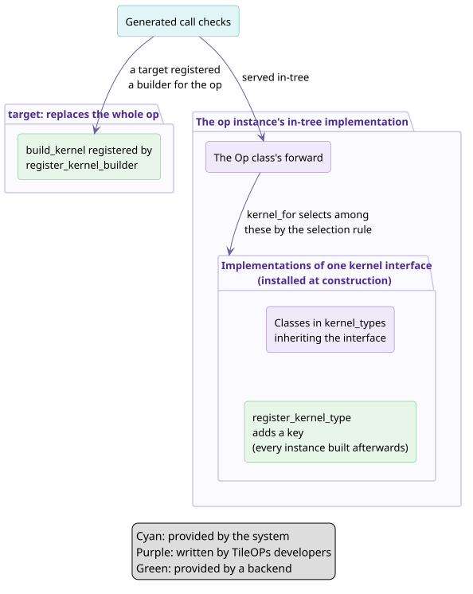

# backend 如何接入 TileOPs

第三方 backend 通过 target 接入：为 op 注册 builder，接管这个 op 的全部调用。TileOPs 各 op 的 kernel 接口与 call spec 不是公开 API，backend 不为单个 kernel 接口新增实现。

## 1. target 与 in-tree 实现各自服务的范围 {#choose}



**图 1** target 与 in-tree 实现各自服务的范围。青色为系统提供的部分，紫色为 TileOPs 开发者编写的部分，绿色为 backend 提供的部分。

**表 1** target 的作用范围

| No. | 项目 | target |
| --- | --- | --- |
| 1 | 改变什么 | op 的全部调用，所有写入张量都为空的调用除外 |
| 2 | 作用于 | 选中该 target 的 op 实例 |
| 3 | 依据的契约 | manifest 中 op 的签名 |

## 2. 替换整个 op：target {#target}

target 协议的完整写法、一个可运行的模板 backend 与常见报错，见[接入新硬件 backend](../../backends.md)。本节只给出概要。

target 是 backend 为一组 kernel 取的名字。target 为某个 op 注册 builder 之后，选中该 target 的 op 实例的调用都由 target 服务，op 自己的 `forward` 不执行。一次调用写入的所有张量都为空时例外：这时 target 与 in-tree 实现都不执行，输出按签名构造。

```python
from tileops.backend import TensorSpec, register_detector, register_kernel_builder
from .kernels import AcmeRMSNorm

register_detector(target="acme", detect=lambda device: device.type == "acme")

def build_rms_norm(x: TensorSpec, weight: TensorSpec | None, *, normalized_shape, eps):
    return AcmeRMSNorm(normalized_shape, eps, x.dtype)

register_kernel_builder(op="RMSNormFwdOp", target="acme", build_kernel=build_rms_norm)
```

- `build_kernel` 按 op 的 `signature.inputs` 顺序接收每个输入的 `TensorSpec`（未传入的可选输入为 `None`，例如 `RMSNormFwdOp` 的 `weight`），并以关键字接收 `signature.params`。它返回的 kernel 在调用时按同样的顺序接收输入张量，并以关键字接收调用方传入的输出缓冲与执行参数。导入模块时不编译任何代码，构建在 `build_kernel` 被调用时发生。
- 返回的 kernel 可选定义 `request_tune()` 与 `config`，含义与 in-tree `Kernel` 的同名成员相同，见[接入新硬件 backend § build_kernel](../../backends.md#build-kernel)。
- op 实例按调用设备，以及每个输入是否传入、dtype 与 shape，缓存 `build_kernel` 返回的 kernel。
- op 实例在第一次需要执行实现的调用中确定 target，此后不变：构造参数 `target=` 优先，其次是 `set_default_target` 设置的进程默认值，最后由各 target 的 detector 检测调用设备；没有 target 认领时使用 in-tree 实现，多个 target 认领时报 `AmbiguousTargetError`。写入张量都为空的调用不确定 target；确定 target 的那次调用失败时，选择被撤销，下一次调用重新确定。
- 传给 target 的调用已经通过由签名生成的检查；除声明了 `device: cpu` 的张量外，所有张量位于调用设备上；所有不被写入的输入都是连续的，被写入的输入在声明了 `contiguous: true` 时是连续的。
- 选中的 target 没有为这个 op 注册 builder、而 op 自己持有 kernel 时，调用报 `OpNotAvailableError`，不退回 in-tree 实现。

注册在 backend 模块被导入时完成。backend 在 `pyproject.toml` 中声明 entry point，TileOPs 在构造第一个 op 时导入它：

```toml
[project.entry-points."tileops.backends"]
acme = "tileops_acme"
```

模块导入失败时，它的全部注册被撤销，TileOPs 发出 `RuntimeWarning`，失败记录可以通过 `tileops.backend.load_failures()` 查看。
